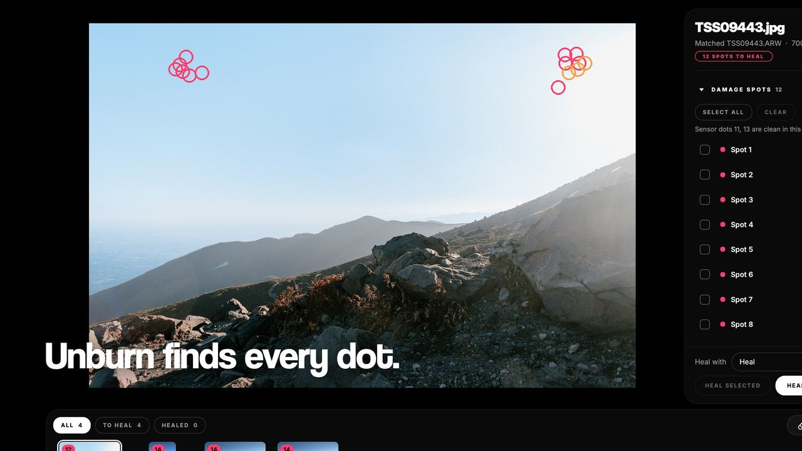
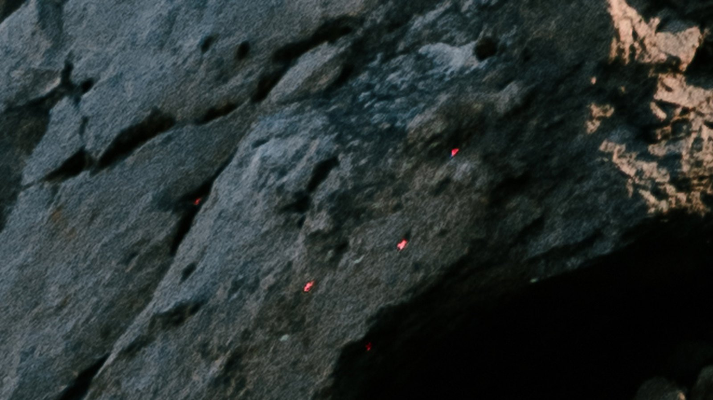
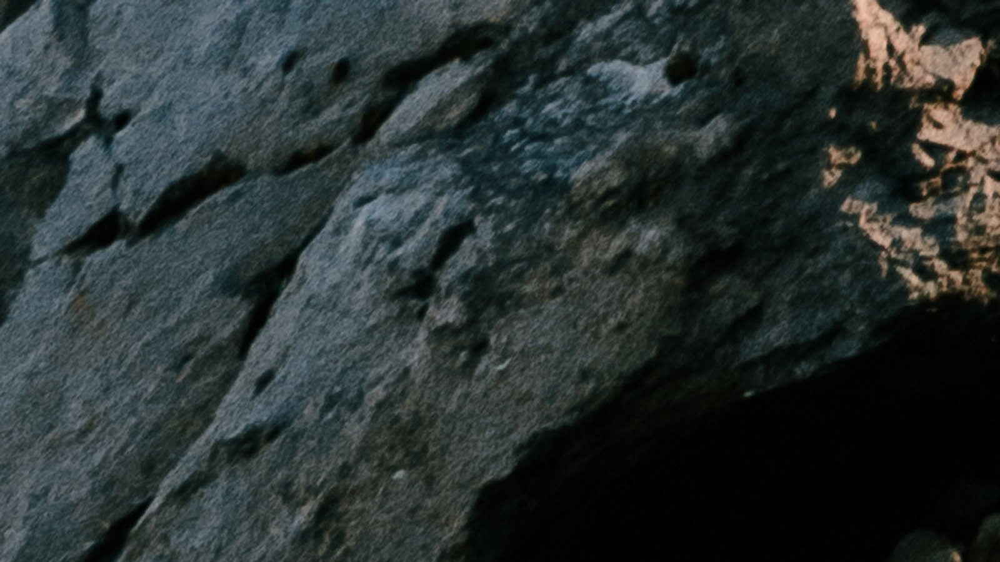
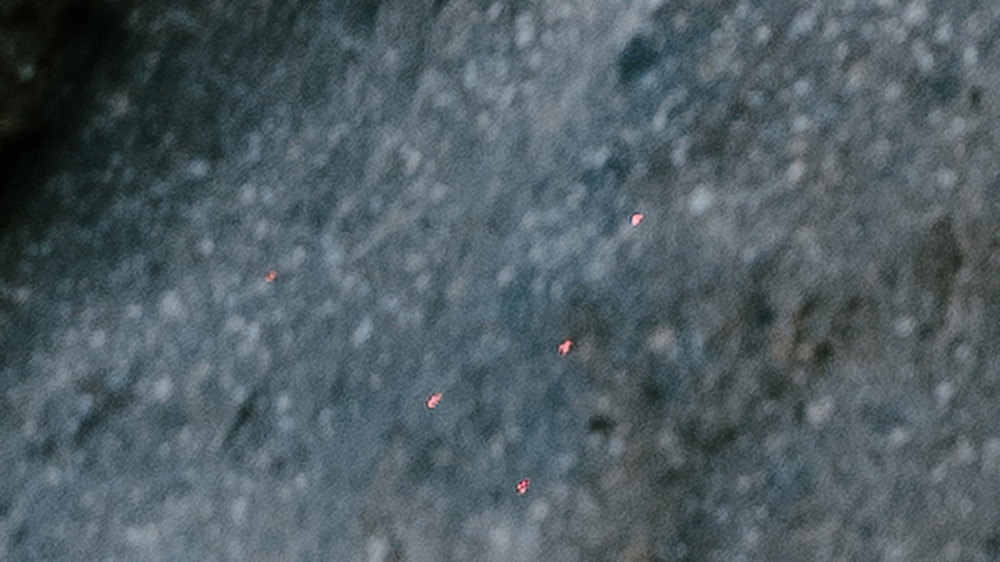
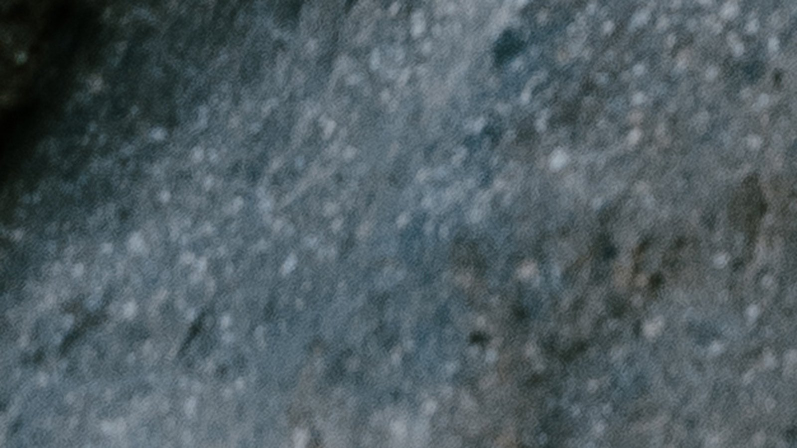

  

<h1 align="center">Unburn</h1>

  <strong>Laser hit your sensor? Unburn every photo.</strong> 
  Finds the damaged pixels in every shot and heals them in one click. For Mac and Windows.

  <a href="https://thatsnowsky.com/unburn"><b>thatsnowsky.com/unburn</b></a> · free trial

---

  

A show laser leaves the same damaged pixels on every photo you shoot. Unburn matches each export to its raw, finds every one of those pixels and heals them, a photo at a time or the whole shoot at once. Your originals are never touched: healed copies are exported alongside them.

## Before and after

| Laser damage | Healed |
| :---: | :---: |
|  |  |
|  |  |
|  |  |

Videos: [demo](media/unburn-demo.mp4) · [calibrating a new camera](media/unburn-calibration.mp4)

## Features

- **Finds every dot.** Matches each export to its raw, so it knows exactly where your sensor is burned, even in a cropped or resized edit.
- **Heals in one click.** A spot, a photo, or the whole shoot. Remove and generative Remove handle the hard spots.
- **Any camera.** A one-minute calibration learns your body's damage: Canon, Nikon, Sony, Fujifilm (including X-Trans), Panasonic, OM System, Pentax, Leica, Hasselblad and DNG.
- **Originals untouched.** Healed copies only, with colour profile and metadata kept.
- **Offline.** Runs on your computer; your photos never leave it.

Unburn fixes fixed dots and dot clusters that sit in the same place on every frame. It doesn't fix line damage (a thin streak across the frame) or dust that moves between shots.

## Download

Get it from **[thatsnowsky.com/unburn](https://thatsnowsky.com/unburn#download)**, or from the [latest release](https://github.com/thatsnowsky/unburn/releases/latest):

- Mac with Apple Silicon: `Unburn-AppleSilicon-macOS.dmg`
- Mac with Intel: `Unburn-Intel-macOS.dmg`
- Windows 10 or 11 (64-bit): `Unburn-Windows-x64.zip`

Requires macOS 12 Monterey or later, or Windows 10/11 64-bit.

**First open:** Unburn isn't code-signed yet, so your computer warns you once. On a Mac, right-click Unburn in Applications and choose Open (on macOS 15, use System Settings ▸ Privacy & Security ▸ Open Anyway). On Windows, click More info, then Run anyway.

## Free trial and pricing

Download it and scan your photos for free: it finds and heals every dot, with a light watermark on the preview. Buy when you want to export the clean photos.

**$39.90 lifetime**, updates included, or **$9.90/month** for a one-off rescue. One licence covers 2 computers, Mac or PC.

👉 **[Buy at thatsnowsky.com/unburn](https://thatsnowsky.com/unburn)**
