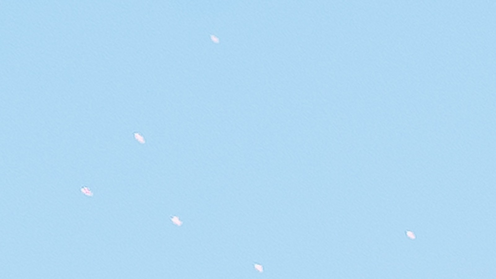
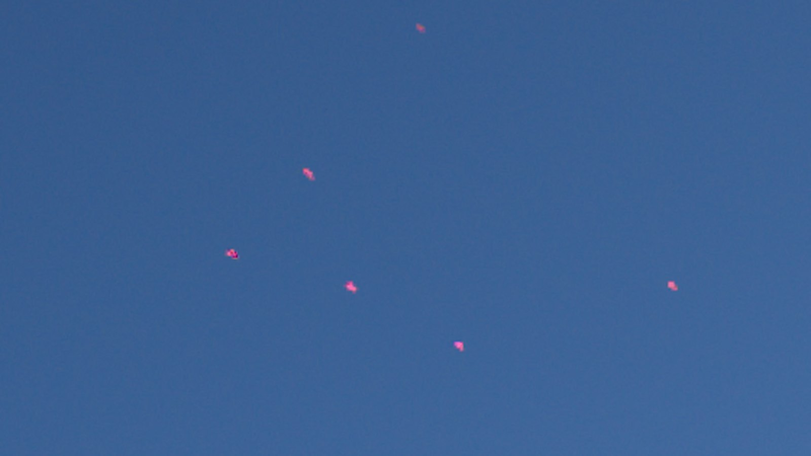
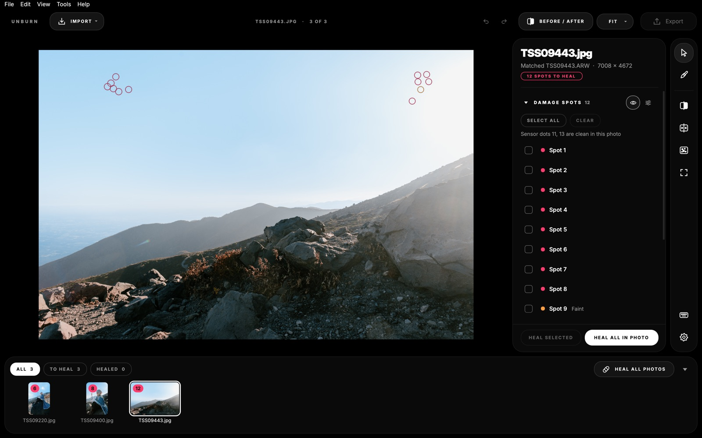
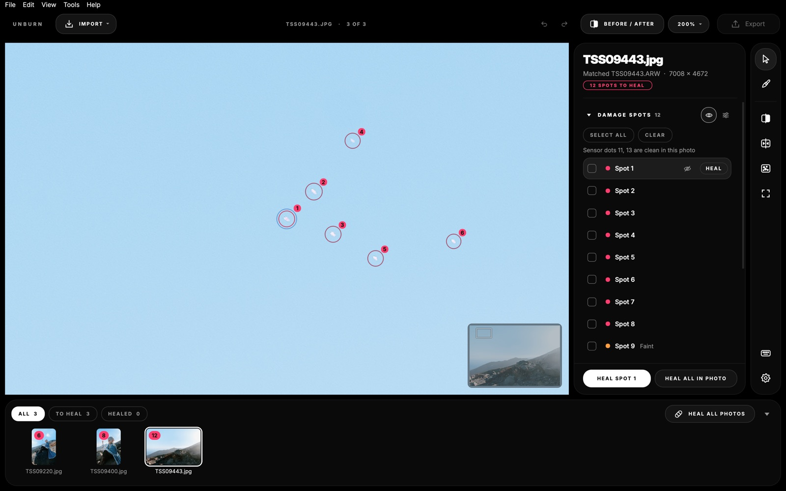
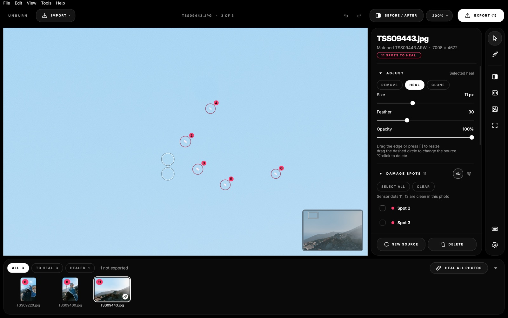
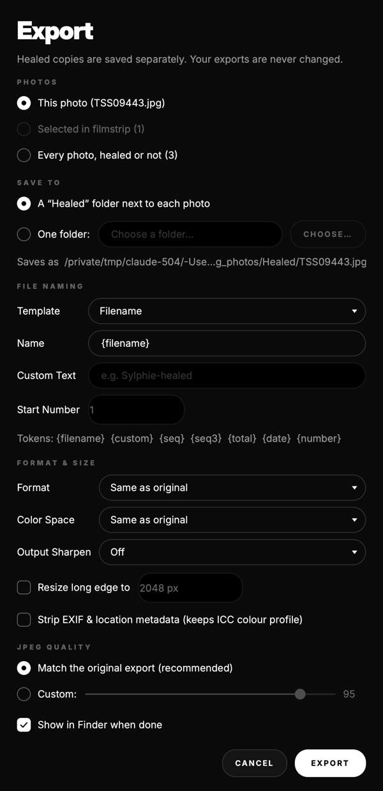

  

<h1 align="center">Unburn</h1>

  <strong>Fast, intelligent sensor damage and laser hotspot healer for macOS photo exports.</strong> 
  Heals stuck pixels, laser damage, and burnt sensor photosites without touching your original RAW files.

  
  
  

---

## 🌐 Live Product Page

Visit the interactive webpage with live before/after sliders, video demos, and FAQ:  
👉 **[https://thatsnowsky.github.io/unburn/](https://thatsnowsky.github.io/unburn/)**

---

## Before & After

| Burned (Laser Sensor Damage) | Healed (Unburn One-Click) |
| :---: | :---: |
|  |  |
|  |  |

---

## Video Walkthroughs

- **[Batch Healing Demo Video (MP4)](media/unburn-demo.mp4)** — 20-second screencast showing batch detection and one-click heal.
- **[Sensor Calibration Wizard Video (MP4)](media/unburn-calibration.mp4)** — Isolating sensor-level defects from scene texture for any camera body.

---

## Download

👉 **[Download Unburn 1.0 (.dmg)](https://github.com/thatsnowsky/unburn/releases/download/v1.0.0/Unburn-1.0.dmg)**

### Requirements
- **macOS 12 Monterey** or later
- **Apple Silicon Mac** (M1, M2, M3, M4 or newer)

---

## What It Does

When a camera sensor gets burnt by lasers at concerts, clubs, or events, or develops stuck pixels, the damage appears at the exact same sensor coordinates across every frame.

**Unburn** automatically finds, aligns, and heals these fixed damage clusters in your exported photos:
- **Heals exports with or without RAWs:** Matches exports against original RAWs, or aligns directly using embedded XMP lens geometry and constellation peak matching.
- **Content-aware healing:** Replaces damage using natural surrounding texture, planar illumination correction, and gradient-aware edge reconstruction.
- **Originals stay untouched:** Never modifies your source RAWs or input photos; healed copies are saved to a separate folder with full color management and metadata preservation.
- **Offline & Private:** Fully offline application. No telemetry, no cloud dependencies.

> **Note:** Unburn fixes fixed dots and dot clusters that sit in the same place on every frame. It does not fix line damage (a continuous thin column/stripe across the sensor) or sensor dust that moves between shots.

---

## App Interface

  
  

  
  

---

## Installation & First Open

1. Download [`Unburn-1.0.dmg`](https://github.com/thatsnowsky/unburn/releases/download/v1.0.0/Unburn-1.0.dmg).
2. Open the disk image and drag **Unburn** into your `/Applications` folder.
3. Eject the disk image.

### First Open (macOS Gatekeeper)
Because Unburn is an independent app distributed outside the Mac App Store without an Apple Developer certificate, macOS will display an untrusted developer warning on first launch.

**To open it the first time:**
1. In Finder, open `/Applications`.
2. **Right-click** (or Control-click) **Unburn** and select **Open**.
3. In the confirmation dialog, click **Open**.

*On macOS 15 Sequoia:*
If macOS only shows "Move to Bin" or "Cancel", click Cancel, then open **System Settings ▸ Privacy & Security**, scroll down to the security section, click **Open Anyway** next to Unburn, and confirm with your password/Touch ID. You only need to do this once.

---

## Camera Support & Calibration

Unburn comes with a built-in 14-spot profile for the **Sony ILCE-7M4**.

For any other camera body, use **Camera ▸ Calibrate Camera Sensor...** with:
- 5–10 defocused calibration frames (e.g. wall or plain sky), or
- 15–40 varied RAW/JPEG frames from different shoots.

Supported RAW formats:
- **Canon** (`.CR2`, `.CR3`)
- **Nikon** (`.NEF`)
- **Sony** (`.ARW`)
- **Fujifilm** (`.RAF` — Bayer & X-Trans)
- **Olympus / OM System** (`.ORF`)
- **Panasonic** (`.RW2`)
- **Pentax** (`.PEF`)
- **Leica** (`.DNG`)
- **Hasselblad** (`.3FR`)
- **Apple / DNG** (`.DNG`)

*(Sigma Foveon X3F sensors are not supported).*

---

## Licensing & Purchase

Unburn includes a free evaluation mode that allows testing all healing and calibration features (with a subtle watermark on exports). 

Full commercial licenses (lifetime one-time $39.90 or $9.90/month subscription) can be purchased at:  
👉 **[https://whop.com/checkout/plan_TMlX1Vo7J0VCV](https://whop.com/checkout/plan_TMlX1Vo7J0VCV)**
